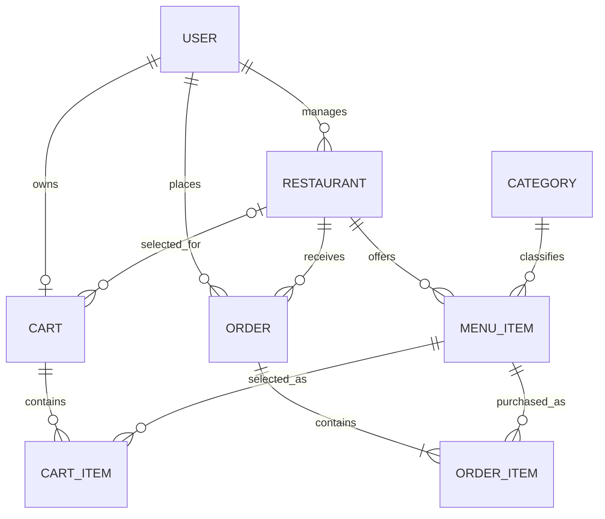

# FoodHub database design

## Entities

| Model | Purpose |
| --- | --- |
| User | Customer, manager or administrator; identity and password hash |
| Restaurant | Manager ownership, contact details, hours and approval status |
| Category | Shared menu categories such as Pizza and Drinks |
| MenuItem | Restaurant menu, category, price and availability |
| Cart | One personal cart per customer; optional restaurant when empty |
| CartItem | Menu item and positive quantity; unique per cart |
| Order | Customer, restaurant, monetary totals, delivery snapshot and status |
| OrderItem | Purchased item name, unit price and quantity snapshots |

All eight tables have an ID primary key and created/updated timestamps.
Foreign-key columns are indexed. Email, category name, cart user ID and order
number are unique; cart items have a composite unique index on cart/menu item.

## ERD

The service creates a cart when registering a customer and requires at least
one order item at checkout. Foreign keys alone cannot enforce these minimums.

## Design choices and required service rules

1. **Money:** amounts are integers in minor units. `500` means $5.00.
   JSON uses `price_minor`, `unit_price_minor`, `subtotal_minor`,
   `delivery_fee_minor` and `total_minor`. For the MVP the platform uses USD,
   matching the PRD examples; the team can choose another single currency.
   Compute totals on the server with overflow checks. Never accept client
   totals. An order check enforces total = subtotal + delivery fee; services
   must also check subtotal against the order item sum.
2. **Accounts:** trim and lowercase emails before storage and login lookup.
   Hash passwords before saving; confirm password belongs only in the
   registration request, never in the database. `json:"-"` hides the hash;
   it does not hash a password. Services enforce unique normalized emails,
   validation, role permissions and suspension.
3. **Restaurants:** `status` represents administrator approval/suspension.
   Managers only toggle `is_accepting_orders`. Browse results include only
   active restaurants; checkout additionally requires accepting orders.
   Store local opening/closing times in HH:MM:SS form; the MVP should use one
   documented operating timezone. Overnight opening hours are valid.
4. **Categories and availability:** categories are shared platform-wide.
   Validate and normalize names before creating them. Explicitly set
   `is_available` when creating menu items; it has no database default.
   Unavailable or soft-deleted menu items cannot be added or checked out.
5. **One restaurant per cart:** proposed policy is to reject an item from a
   second restaurant with a clear error asking the customer to clear the cart.
   Lock the cart row and check the restaurant inside a transaction for all
   cart mutations. The restaurant ID is null when empty. Delete cart item rows
   when removing/clearing; reset the restaurant ID when the last item is removed.
   The model index prevents duplicate rows, but cross-table ownership and the
   one-restaurant invariant must be enforced by the service.
6. **Checkout:** in a single transaction lock the cart and relevant menu rows,
   confirm ownership, restaurant state, availability and positive quantities,
   recompute current prices, allocate the order number, create the order and
   its items, then clear cart items and reset its restaurant ID. Roll back
   everything on failure. Payment is simulated; no payment provider is modeled.
7. **Snapshots:** copy delivery details into the embedded order columns.
   Copy menu name and unit price into each order item. History reads use these
   snapshots, so later menu/profile edits cannot change an existing order.
8. **Order number:** generate `ORD-YYYYMMDD-NNN` in the checkout service. The
   unique index is a safety net, not the generator. Use a locked daily counter
   or a transaction-level advisory lock with unique-conflict retries. Do not
   use an unlocked count of orders; define the business timezone with the team.
   Treat NNN as a minimum width so day counts beyond 999 remain unique.
9. **Status flow:** Pending → Confirmed → Preparing → Ready for Delivery →
   Out for Delivery → Delivered. Delivered/Cancelled are final. The included
   helper proposes cancellation from Pending or Confirmed only: the owning
   customer, owning restaurant manager or admin may cancel in those states.
   The team should review this choice. The service must authorize the actor,
   call `CanTransitionTo`, and update with a row lock or a conditional write
   checking the existing status. Direct database saves can bypass the helper.
10. **Deletion:** menu items are soft deleted to retain historical references.
    Orders restrict deletion of their customer, restaurant and referenced menu
    items. Suspend users/restaurants rather than deleting history. Cart/item
    rows are hard deleted; GORM's foreign-key actions clean up dependent rows.
11. **Filtering:** use parameterized GORM queries and paginate list endpoints.
    Ordinary name indexes support basic equality queries; substring searches
    may need PostgreSQL trigram indexes once actual query patterns are known.

These models do not implement JWT, hashing, logout/revocation, authorization,
request validation, REST endpoints, checkout transactions or a live database.
They supply the schema used by those later tasks.
